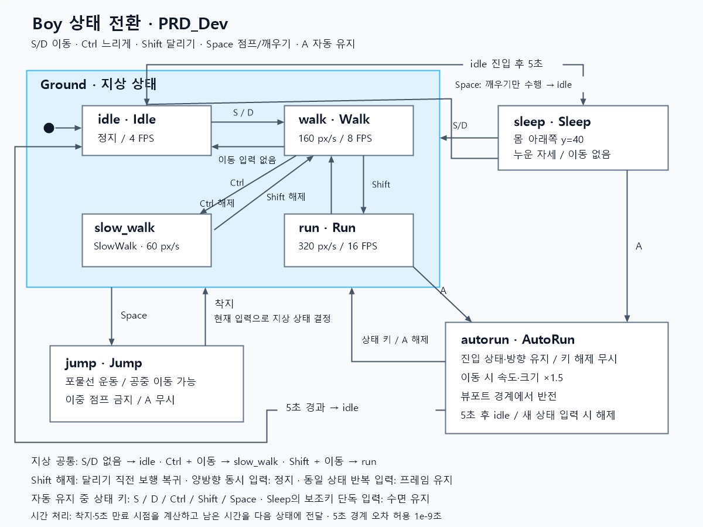

# Boy 상태 기반 이동 상세 개발 명세서

## 1. 목적과 범위

수정된 `PRD.md`를 기준으로 `Boy.py`와 `main.py`에 일곱 상태를 구현한다.
기존 pico2d 리소스, transitions 상태 머신, 지면 정렬, 좌우 Shift/Ctrl 처리를 재사용한다.
각 상태는 별도 클래스로 구현하며 상태 전환은 transitions가 담당한다.
새 리소스, 새 의존성, 별도 게임 프레임워크는 추가하지 않는다.

## 2. 조작과 수치

S/D 이동과 A 자동 유지 진입은 최신 PRD의 지정 사항이다.
나머지 조작, 배율과 물리 수치는 구현을 위한 기본 결정이다.

| 입력 | 동작 |
| --- | --- |
| S / D | 좌 / 우 이동. 동시에 누르면 정지 |
| Ctrl + S / D | 느린 걷기. 좌우 Ctrl 모두 지원 |
| Shift + S / D | 달리기. 좌우 Shift 모두 지원. Ctrl보다 우선 |
| Space | 지상에서 점프. 수면 중에는 깨우기만 수행 |
| A | 현재 지상 상태를 자동 유지. 자동 유지 중 다시 누르면 해제 |
| Escape / 창 닫기 | 프로그램 종료 |

걷기 160 px/s, 느린 걷기 60 px/s, 달리기 320 px/s를 유지한다.
자동 이동 중 속도와 크기는 기존 상태의 1.5배로 설정한다.
점프 초기 속도는 420 px/s, 중력은 980 px/s²로 설정한다.
점프 중에도 S/D 및 보조키로 수평 이동을 조절하며 이중 점프는 금지한다.
점프 중 A는 무시한다. 별도 점프 이미지가 없어 현재 이동 상태의 시트를 재사용한다.

## 3. 상태 클래스와 전환

| PRD 상태 | 클래스 / 내부 상태명 | 동작 및 종료 조건 |
| --- | --- | --- |
| idle | Idle / idle | 제자리 4 FPS 애니메이션. 진입 후 5초에 수면 |
| sleep | Sleep / Sleep | 기존 호환을 위해 내부 이름 유지. 몸의 아래쪽을 y=40에 놓고 회전 |
| slow_walk | SlowWalk / slow_walk | idle 시트, 8 FPS, 60 px/s |
| walk | Walk / walk | 이동 시트, 8 FPS, 160 px/s |
| run | Run / run | 이동 시트, 16 FPS, 320 px/s |
| jump | Jump / jump | 수평 이동과 포물선 운동. 착지 시 현재 입력에 맞는 지상 상태 |
| autorun | AutoRun / autorun | 진입 시 지상 상태·방향을 저장. 키를 놓아도 유지 |

상태 클래스는 `transitions.State`를 상속하고 상태별 진입·업데이트·그리기를 담당한다.
공통 프레임 계산, 수평 이동, 입력 집계, 스프라이트 그리기는 Boy에서 공유한다.
상태가 실제로 바뀔 때만 프레임과 idle 타이머를 초기화한다.
Shift를 놓으면 달리기 시작 직전의 walk 또는 slow_walk로 복귀하는 기존 동작을 유지한다.
Sleep에서 방향키로 즉시 이동할 수 있다. 보조키만으로는 깨지 않는다.

### 자동 유지의 상세 규칙

1. A를 누르면 idle, Sleep, slow_walk, walk, run 중 현재 상태와 방향을 저장한다.
2. 정지·수면 상태를 저장했다면 이동·확대 없이 해당 자세를 유지한다.
3. 이동 상태를 저장했다면 1.5배 속도와 크기로 이동한다. 확대된 프레임 반폭까지 경계 안에 둔다.
4. 좌우 경계에서는 방향을 반전한다. 큰 dt로 여러 경계를 지나도 남은 이동 거리를 반영한다.
5. 시작 후 5초에 idle로 전환한다. 키를 놓는 이벤트나 무관한 키는 시간을 연장하지 않는다.
6. 자동 유지 중 S/D/Ctrl/Shift/Space의 새 keydown은 자동 유지를 즉시 해제하고 해당 입력을 처리한다.
7. A의 키 반복은 재전환하지 않는다. 키 해제 이벤트는 저장된 이동을 중단하지 않는다.
8. 시간 만료 시 유지 입력을 지워 다음 입력까지 정지한다. 이후 idle 5초가 지나면 Sleep으로 전환한다.

### 점프와 경계

지상 중심 y는 `GROUND_Y + 36 = 91`이다. 발 정렬 보정은 기존 FOOT_PADDING을 사용한다.
수직 위치는 `y += vy*dt - 0.5*g*dt²`, 속도는 `vy -= g*dt`로 계산한다.
갱신 도중 착지한다면 포물선의 지면 교차 시각을 계산하여 착지 전후 시간을 나눈다.
착지 후 남은 시간은 현재 지상 상태에 전달한다. 정지 착지 후 5초가 지나면 같은 갱신에서도 수면에 진입한다.
착지 시 y=91, vy=0으로 고정한다. 일반 상태에서는 프레임 반폭 50으로 좌우를 제한한다.
자동 이동은 크기 1.5일 때 반폭 75를 사용한다. 창이 프레임보다 좁으면 중앙에 고정한다.

## 4. 실행 루프

`main.py`의 이벤트 전달, 업데이트, 렌더링 구조를 유지한다.
실제 경과 시간은 perf_counter로 계산하여 상태에 한 번 전달한다.
각 상태는 착지·5초 만료 시점에서 경과 시간을 나누어 다음 상태로 전달한다.
긴 프레임에서도 idle·autorun의 5초는 실제 누적 시간 기준으로 동작하며 시간 비례 반복 갱신을 하지 않는다.
5초 경계의 부동소수점 오차는 절대 오차 1e-9초 이내에서 허용한다.
창을 닫거나 Escape를 누른 프레임에서는 갱신과 렌더링을 중단한다.
이미지 경로는 각 Python 파일의 위치를 기준으로 계산하여 다른 폴더에서도 실행할 수 있다.

## 5. 산출물과 커밋

- `PRD_Dev.md`: 결정 사항, 상태 전환, 구현 및 검증 기준.
- `boy_state_diagram.svg`: 명세 기반 상태 다이어그램 이미지.
- `boy_state_diagram.png`: 문서 뷰어용 상태 다이어그램 이미지.
- `Boy.py`, `main.py`: 상태 클래스 및 게임 루프 구현.
- `test_boy.py`: 실제 transitions를 사용하는 비화면 회귀 테스트.
- `test_main.py`: 긴 프레임의 경과 시간 보존 및 종료 이벤트 검사.
- 커밋은 기존 형식 `003_명세_상세 내용`을 이어 사용한다. 번호는 3자리, 주요내용은 2자, 상세 내용은 한국어로 작성한다.
- 이번 변경은 명세·도식·상태별 구현·입력·물리·렌더링·검증 단위로 20개 이상 커밋한다.

## 6. 검증과 완료 조건

`python -m unittest -v`로 기존 회귀 테스트와 추가 테스트를 통과시킨다.
별도 화면 조작 없이 상태 클래스 등록, 입력 우선순위, 타이머, 점프, 착지, 자동 유지·해제,
경계 반사, 배율과 발 정렬을 검사한다. 실제 라이브러리로 SDL dummy 렌더링도 확인한다.
Computer-Use를 이용한 조작은 사용자 승인 없이는 수행하지 않는다.

자동 테스트 통과, 다이어그램 생성, 20개 이상 커밋 기록을 완료 조건으로 삼는다.
실제 창에서의 수동 조작 검증 여부는 최종 보고에 명시한다.

## 7. 상태 다이어그램

이미지에서 Ground는 idle/slow_walk/walk/run의 묶음이다. 해당 묶음의 모든 상태에서 점프와 자동 유지가 가능하다.
Sleep도 자동 유지에 진입할 수 있다. jump에서는 A를 무시한다.

## 8. 구현 검증 결과

- Python 3.13 / transitions 0.9.3에서 자동 테스트 42개를 통과했다.
- 실제 pico2d와 SDL dummy 드라이버로 일곱 상태의 좌우 방향 14프레임을 렌더링했다.
- 최신 PRD의 S/D 이동, A 자동 유지 조작을 코드·테스트·도식에 반영했다.
- 실제 창에서 키보드를 조작하는 수동 검증은 수행하지 않았다.

## 9. 후속 점검과 보완

현재 PRD는 직전 구현 시점과 동일하다. 기존의 A/D 이동에서 S/D 이동, A 자동 유지 진입으로 바뀐 사항과
자동 유지 중 다른 상태 키 입력 시 즉시 해제하는 조건이 코드와 도식에 일치하는지 다시 확인했다.

재현한 오류와 수정 내용은 다음과 같다.

1. 0.1초 갱신을 50회 수행하면 합산 오차 때문에 idle·autorun 종료가 한 프레임 늦었다. 시간 경계 허용 오차로 보완했다.
2. 한 번의 긴 점프 갱신에서 착지 후 남은 시간이 누락되었다. 정확한 착지 시각에 지상 상태로 전환하고 잔여 시간을 전달한다.
3. 긴 정지 후 복귀하면 경과 시간에 비례해 반복 갱신했다. 상태별 해석 계산을 이용하여 반복을 제거했다.
4. 다른 폴더에서 main.py를 실행하면 grass.png를 찾지 못했다. Boy와 동일하게 파일 기준 경로를 사용한다.
5. 수면 진입 시 입력 초기화가 두 곳에 중복되었다. Sleep 상태의 진입 처리만 유지한다.

## 10. 파일 정리

실행에서 사용하지 않는 루트의 `boys_team_10000.py`, `ball21x21.png`, `ball41x41.png`, `run_animation.png`를 제거했다.
문서, 다이어그램, 회귀 테스트와 렌더링 검증 도구는 유지한다.
`docs`, `screenshots`, `__pycache__` 아래 파일은 삭제하지 않고 루트로 이동했다.
기존 비교 이미지의 이름 충돌은 `before_`, `after_` 접두사로 구분한다.
이동 직후 모든 파일의 SHA256이 원본과 같은지 확인한 뒤 빈 폴더만 삭제했다. `.git`은 유지한다.
기존 바이트코드 파일은 루트에 보존하지만 `.gitignore`의 `*.py[cod]` 규칙에 따라 커밋하지 않는다.

렌더링 검증 명령은 `python -B capture_ground.py <출력 폴더>`이다.
출력 폴더는 저장소 외부의 절대 경로를 사용한다. 테스트는 `python -B -m unittest -v`로 실행한다.
일반 실행은 Python이 `__pycache__` 폴더를 다시 생성할 수 있으므로, 폴더 생성을 피하려면 `python -B main.py`를 사용한다.
